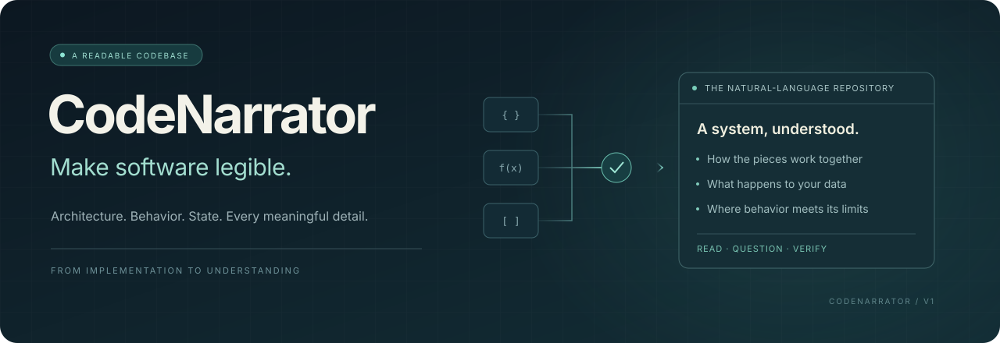

<p align="center">
  
</p>

<h1 align="center">CodeNarrator</h1>

<p align="center"><strong>让理解软件，不再以熟练阅读源码为前提。</strong><br>Turn an entire codebase into a repository humans can read.</p>

<p align="center">
  <a href="https://github.com/azhimiao/CodeNarrator/actions/workflows/ci.yml"></a>
  <a href="https://github.com/azhimiao/CodeNarrator/releases"></a>
  
  <a href="LICENSE"></a>
  
</p>

<p align="center">
  <a href="examples/visprog自然语言仓库/开始阅读.md">阅读真实译本</a> ·
  <a href="#开始使用">开始使用</a> ·
  <a href="docs/使用指南.md">使用指南</a> ·
  <a href="docs/V1验收记录.md">验证证据</a> ·
  <a href="https://github.com/azhimiao/CodeNarrator/releases/latest">下载</a>
</p>

---

## 软件值得被更多人理解

一个软件项目，把知识压缩进了代码。

算法、设计选择、数据流、隐含约定、依赖库行为，以及那些只在失败时才暴露的细节，都藏在文件、函数与调用之间。第一次进入一个项目的人，必须先支付理解语言、框架、作者习惯和项目历史的成本，才能开始理解项目本身。

**CodeNarrator 希望改变这个起点：把软件的实现，变成可以直接阅读、讨论和审查的自然语言知识。**

当 AI 能协助完成越来越多的编码工作，人类理解、判断与追问实现的能力应当同步增强。科研复现需要知道实验实际上怎样运行，工程协作需要知道一次修改影响哪里，审查需要知道数据流向何处、异常发生以后留下什么。对软件的信任，需要建立在能够理解实现的基础上。

我们的目标是一个完整的**自然语言仓库**：从整体架构到具体处理步骤，从跨文件关系到共享状态，从依赖契约到失败边界，读者沿着自然语言就能理解实现，无需来回打开源码寻找答案。

> **代码可以由少数人编写。理解软件的入口，应当向更多人开放。**

## 一份仓库，两种可读的表达

CodeNarrator 是交给编程 Agent 使用的 Skill。Agent 阅读真实项目、追踪关系并编写译文；确定性工具负责索引、上下文组织、分块、证据关联、更新检测与交付检查。


输出是一套可以脱离源码目录阅读的 Markdown 文档。每个局部过程都有全局位置，每条执行路线都有具体步骤，每个重要结论都有构建记录中的来源。

| 你想理解的事 | 自然语言仓库应当回答 |
|---|---|
| 项目如何工作 | 入口、组件分工、完整执行路线与组件之间的协作 |
| 一段实现具体做了什么 | 输入条件、处理顺序、分支、返回值与副作用 |
| 数据后来发生了什么 | 状态读写、对象共享、原地修改与生命周期 |
| 调用一个库究竟意味着什么 | 参数含义、版本约束、默认值与失败条件 |
| 出错之后会怎样 | 哪一步失败、此前的修改是否保留、调用方会看到什么 |
| 项目更新后哪里需要重读 | 输入变动、导入影响与待复核的旧译文 |

读者可以是第一次接触项目的学生、已有经验的开发者，或需要核查实现的领域研究者。`student`、`developer`、`domain` 三种背景改变解释深度，同时保留相同的实现事实。

## 先读一个真实项目

我们以 [VisProg](https://github.com/allenai/visprog/tree/9626868c0d1007c41d8f210fe99f5c1facc3325f) 为完整案例：一个通过视觉程序组合完成问答、推理、编辑和知识标注任务的科研项目。

**[打开 VisProg 自然语言仓库 →](examples/visprog自然语言仓库/开始阅读.md)**

| 交付范围 | 实际结果 |
|---|---:|
| 核心实现、提示、Notebook 与项目文本 | 16 份输入 |
| 自然语言文档 | 28 份 Markdown |
| 由译文承接的索引结构 | 2,105 个 |
| 逐格说明的 Notebook 保存单元格 | 41 个 |
| 逐步展开的提示示例 | 55 段 |
| 端到端任务路线 | 4 类 |

在这份译本里，你可以直接追问：

- 一个结果步骤执行以后，后面的步骤是否还会运行？
- 计数展示失败时，计数值是否已经写入共享状态？
- 没有检测到目标时，“向上裁图”和“向下裁图”实际上截取哪里？
- 图像修补是否修改了原始对象的掩膜？
- 提示中的示例程序，有哪些在实际实现里会报错？

这些问题在正文里都有具体答案，并对应真实实现的行为核查。细节越反直觉，越需要被清楚地写出来。

还可以阅读 [记录筛选小项目](examples/自然语言仓库/开始阅读.md) 和 [PyPA sampleproject](examples/sampleproject自然语言仓库/开始阅读.md)。所有译本的上游来源与许可均保留在仓库中。

## 开始使用

需要 Python 3.10+ 和一个能够读取项目、执行脚本的编程 Agent。Skill 工具本身只使用 Python 标准库。

```bash
git clone https://github.com/azhimiao/CodeNarrator.git
cd CodeNarrator
python scripts/install_skill.py
```

默认安装到 `CODEX_HOME/skills`；未配置 `CODEX_HOME` 时使用 `~/.codex/skills`。已有安装可显式运行 `python scripts/install_skill.py --update`，旧版本会保留为 ZIP 备份。

随后向支持 Skill 的 Agent 发出请求：

> 使用 $code-narrator，把这个项目完整翻译为中文自然语言仓库。读者是学过基础编程、第一次接触该项目的软工学生。构建记录放到独立目录，成品放到新的输出目录。请完整说明实现、跨文件关系、数据、依赖与异常，让我只读译文就能理解项目。

其他能够遵循文件指令的 Agent 也可以直接读取 [SKILL.md](code-narrator/SKILL.md)。无需另设模型服务；理解与写作由你使用的 Agent 完成。

独立安装包见 [Releases](https://github.com/azhimiao/CodeNarrator/releases/latest)。CLI、增量更新、产物结构和复现步骤见 [使用指南](docs/使用指南.md)。

## 为可信的理解而设计

一次完整翻译需要同时处理**实现事实、项目关系与读者理解**。

- **沿真实结构阅读。** Python 语法树、Notebook 单元格、导入候选、反向引用与邻居符号共同组织上下文，长实现按定义边界分块。
- **把关系写清楚。** 组件、动态分派、共享状态、对象别名、依赖契约与执行路线都有专门的理解记录。
- **保留可核查的依据。** 译文与输入快照关联，正文改动使旧复核失效，缺失结构、失效引用和过期来源会阻止交付。
- **让成品独立成立。** 最终目录包含自然语言 Markdown、内部导航与必要许可原文；索引、结构编号和构建数据留在工作目录。
- **允许持续维护。** 项目变化后保留旧译文，列出新增、修改、删除与导入影响，再由 Agent 复核并发布新版本。

结构覆盖只能证明有对应关系；语义正确还需要具体行为核查与独立阅读。仓库公开保留了覆盖完整、正文空泛的[反例实验](docs/coverage-regression-result.json)，以及发现问题、修改译文、再次核查的[完整验收记录](docs/V1验收记录.md)。

## 已经交付，继续向前

V1 已交付可复用 Skill、真实仓库完整译本、安装与分发工具，以及 **41 项全部通过、零跳过的本地测试记录**。两轮独立 Agent 阅读检查发现的问题已回写到译本中。自动化测试也可在本仓库的 [Actions](https://github.com/azhimiao/CodeNarrator/actions) 中查看。

当前深度支持 Python 和 Python Notebook。语言扩展、真实学生的理解效果研究、更大规模仓库的持续验证，是后续方向。已有验证涵盖工具一致性、具体行为和阅读问题；完整视觉模型端到端运行、人类参与者实验与任意项目的语义准确率尚未验证。

**愿景很大，结论有据。每一个可以被读懂、被追问、被核查的实现细节，都是向这个愿景推进的一步。**

## 参与这件事

欢迎带来一个难读的项目、一处解释不清的行为、一份失败案例，或者一位真实读者的反馈。能帮助读者准确理解实现的改进，都是重要贡献。

参见 [贡献指南](CONTRIBUTING.md)、[项目定义](CodeNarrator_项目定义与开发方案_V0.3.md) 和 [技术与参考调研](docs/Understand-Anything调研与交付审计.md)。

本项目参考了 [Understand Anything](https://github.com/Egonex-AI/Understand-Anything/tree/4e6d3299017a7432da15957874992837a315c5b4) 在仓库扫描、关联上下文、分批分析、架构与导览方面的方法，工具代码独立实现。感谢 VisProg、PyPA sampleproject 及相关开源工作提供可复核的真实案例。

[MIT License](LICENSE)。第三方内容保留各自许可，见 [THIRD_PARTY_NOTICES.md](THIRD_PARTY_NOTICES.md)。

<p align="center"><strong>Make software legible.</strong><br>让软件成为可以被更多人理解的知识。</p>
